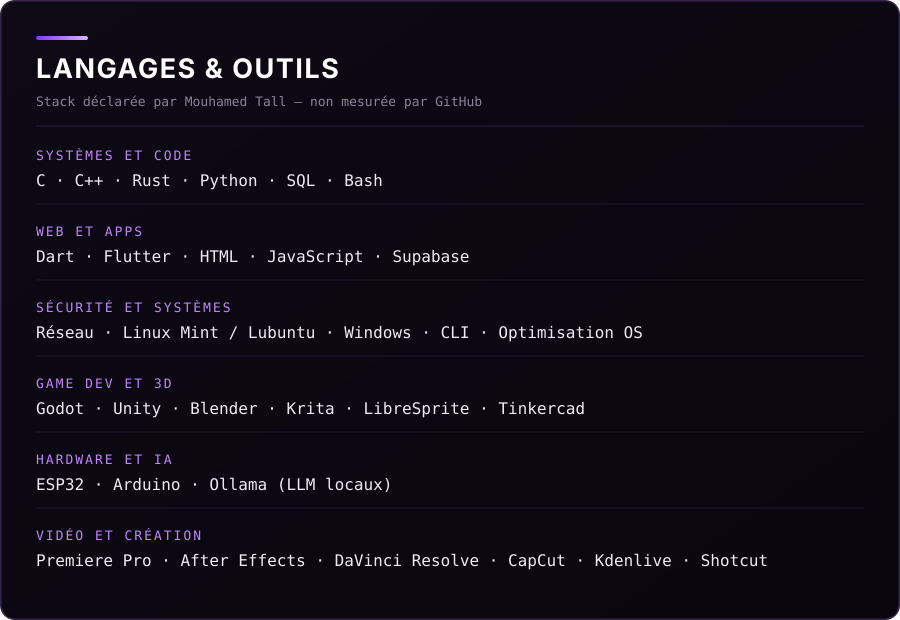

 

 

**Mouhamed Tall | Full Stack Developer**

Développeur curieux, attiré par les systèmes, le code bas niveau et les expériences interactives. 
J'explore, j'apprends et je construis — du C à Flutter, en passant par Rust, Python et Godot.

---

## 🛠️ Compétences & Technologies

* **Langages & Bas niveau :** C, C++, Rust, Python, Dart, HTML/JS, SQL, Bash
* **Cybersécurité & Systèmes :** Sécurité système/réseau, Dual-Boot Linux (Mint, Lubuntu) / Windows, CLI, Optimisation OS
* **Game Dev, 3D & Art :** Godot Engine, Unity, Blender, Krita, LibreSprite, Tinkercad
* **Apps, IA & Hardware :** Flutter, Supabase, Ollama (LLM locaux), ESP32, Arduino
* **Création vidéo & Créateur :** Premiere Pro, After Effects, DaVinci Resolve, CapCut, Kdenlive, Shotcut

> Ces compétences sont déclarées par le propriétaire du profil. Aucune expérience professionnelle, diplôme ou métrique non vérifiée n'est affichée ici.

---

## 🚀 Featured Projects

| Projet | Description | Nature / Stack |
| :--- | :--- | :--- |
| [**supermane2024-del/supermane2024-del**](https://github.com/supermane2024-del/supermane2024-del) | Portfolio GitHub animé : bannière Dark Developer, titre machine à écrire, cartes dynamiques et Snake des contributions généré par GitHub Actions. | GitHub Actions · SVG · Markdown |
| [**blink**](https://github.com/supermane2024-del/blink) | Blink Mobile Shell for iOS (Mosh based). Fork public de [blinksh/blink](https://github.com/blinksh/blink), conservé comme référence — aucun commit personnel sur ce fork. | Swift · iOS · Mosh |

> Les autres dépôts du compte sont privés et ne sont donc pas présentés ici.

---

## 📊 Statistiques GitHub

Données publiques, actualisées automatiquement par le service [github-readme-stats](https://github.com/anuraghazra/github-readme-stats).

---

## 🌐 Langages & outils

📈 Voir la carte GitHub dynamique des langages (données publiques)

 

*Cette carte se remplit automatiquement dès que des langages sont détectés dans les dépôts publics.*

---

## 🐍 Snake des contributions

Le serpent traverse la grille de contributions publiques. Le SVG est régénéré chaque jour et publié sur la branche `output` par [Platane/snk](https://github.com/Platane/snk).

<picture>
  <source media="(prefers-color-scheme: dark)" srcset="https://raw.githubusercontent.com/supermane2024-del/supermane2024-del/output/github-contribution-grid-snake-dark.svg">
  <source media="(prefers-color-scheme: light)" srcset="https://raw.githubusercontent.com/supermane2024-del/supermane2024-del/output/github-contribution-grid-snake.svg">
  
</picture>

---

## 📫 Contact

- **GitHub :** [@supermane2024-del](https://github.com/supermane2024-del)
- **E-mail :** [supermane2024@gmail.com](mailto:supermane2024@gmail.com)
- **Dépôt du profil :** [supermane2024-del/supermane2024-del](https://github.com/supermane2024-del/supermane2024-del)

Mouhamed Tall · Construit avec GitHub Actions, SVG et Markdown · Mise à jour automatique

